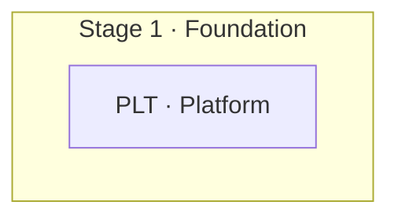

# gh-roadmap

A [GitHub CLI](https://cli.github.com) extension that keeps a GitHub Project board in sync with a `ROADMAP.md` file in your repository.

You plan in `ROADMAP.md` — stages, epics, features, dependencies — and `gh roadmap sync` turns it into issues, sub-issues, "blocked by" links, milestones, labels and a Project board with workflow columns and views. The board stays the place for day-to-day status; the file stays the plan.

## What you get

- **Project board** with the columns Backlog → Todo → In Progress → Blocked → Done → Deployed on Stage → Deployed on Prod
- **Views:** `Kanban` (board by status), `By module`, `Epics` (table with sub-issue progress), `All items`
- **Issues:** one per epic (module × stage) and per feature; features are sub-issues of their epic
- **Dependencies:** the `Depends on` column becomes native "blocked by" links
- **Milestones** `Stage 1…N`, **labels** `type:epic`, `type:feature`, `module:<name>`
- **Project fields** `Module` and `Level` (Epic / Feature) filled on every card
- **Links back:** issue numbers are written into `ROADMAP.md`

## Requirements

- [GitHub CLI](https://cli.github.com) authenticated with the `repo` and `project` scopes:
  ```bash
  gh auth refresh -s project
  ```
- Node.js 20 or newer
- On Windows: Git for Windows (gh runs the extension through its `sh`)

## Install

```bash
gh extension install DevAgassi/gh-roadmap
gh extension upgrade roadmap      # later, to update
```

The repository is private: installing requires read access to it, through your `gh` login.

## Quick start

In the root of a repository that is already on GitHub:

```bash
gh roadmap init            # creates roadmap.config.json, ROADMAP.md, the Project, columns and views
# edit roadmap.config.json (modules) and ROADMAP.md (stages, epics, features)
gh roadmap sync --dry-run  # validates ROADMAP.md without touching GitHub
gh roadmap sync            # creates/updates issues and the board
```

`init` ends with a short checklist of settings the GitHub API cannot change (the column for newly added items, grouping the `By module` view by Module, hiding unused deployment columns). Do them once in the browser.

## Commands

| Command | What it does |
|---|---|
| `gh roadmap init [--repo owner/name] [--title "…"]` | Creates `roadmap.config.json` and `ROADMAP.md` if missing; creates the Project if missing; sets status columns, `Module` / `Level` fields and views. Safe to re-run |
| `gh roadmap sync [--dry-run]` | Syncs `ROADMAP.md` to GitHub. With `--dry-run` only validates the file |
| `--config <path>` | Use another config file (default `roadmap.config.json`) |

### Sync guarantees

- **Idempotent:** existing issues, links and cards are detected and skipped; re-running only applies what changed.
- **Board status is never overwritten.** Only empty fields are filled; new issues start in `newIssueStatus` (default `Backlog`).
- **Titles follow `ROADMAP.md`.** Renaming an issue on GitHub is reverted on the next sync — rename in the file instead.
- **Custom columns and views are kept.** New statuses, modules and views from the config are added; nothing is deleted.
- **Dropped features:** set the registry status to `dropped` and the issue is closed as *not planned*.

## Configuration — `roadmap.config.json`

```json
{
  "repo": "DevAgassi/flower-network",
  "roadmap": "ROADMAP.md",
  "defaultBranch": "main",
  "project": { "title": "Flower Network", "owner": "DevAgassi" },
  "modules": {
    "PLT": { "name": "platform", "color": "6b7280" },
    "INV": { "name": "inventory", "color": "16a34a" }
  },
  "links": [{ "label": "init.md", "path": "init.md" }],
  "newIssueStatus": "Backlog"
}
```

| Key | Required | Default | Meaning |
|---|---|---|---|
| `repo` | yes | — | `owner/name` of the repository that holds the issues |
| `project.title` | yes | — | Project name; found by title, created if missing |
| `project.owner` | no | repo owner | User or organization that owns the Project |
| `modules` | yes | — | Module code (2–5 uppercase letters, the ID prefix) → `name` and hex `color` for the label |
| `roadmap` | no | `ROADMAP.md` | Path of the roadmap file, relative to the config |
| `defaultBranch` | no | `main` | Used for links to files in issue bodies |
| `links` | no | `[]` | Extra documents linked from every issue body (`label`, `path`) |
| `statuses` | no | 7 columns above | `Status` options: `name`, `color` (GRAY, BLUE, GREEN, YELLOW, ORANGE, RED, PINK, PURPLE), `description` |
| `newIssueStatus` | no | first status | Status set on newly added cards |
| `labels` | no | `type:epic`, `type:feature`, `module:` | Label names: `epic`, `feature`, `modulePrefix` |
| `views` | no | Kanban, By module, Epics | `name`, `layout` (`BOARD_LAYOUT`, `TABLE_LAYOUT`, `ROADMAP_LAYOUT`), `filter`, `fields` (field names). Created only if no view with that name exists |

## ROADMAP.md format

~~~markdown


<!-- epics:start -->
<!-- epics:end -->

| ID | Epic | Feature | Depends on | Status | Issue |
|---|---|---|---|---|---|
| PLT-01 | E_PLT_S1 | Repository setup | — | todo | |
| PLT-02 | E_PLT_S1 | CI pipeline | PLT-01 | todo | |
| PLT-03 | E_PLT_S1 | Docs site | PLT-01…PLT-02 | dropped | |
~~~

- **Stages:** Mermaid subgraphs `subgraph S<n>["Stage <n> · <name>"]`.
- **Epics:** Mermaid nodes `E_<MODULE>_S<n>["<MODULE> · <title>"]`, one per module and stage.
- **Features:** table rows with single spaces around `|`. `Depends on` takes IDs, comma-separated, ranges `A-01…A-03`, or `—`. `Status` is `todo`, `done` or `dropped`. `Issue` is filled by sync.
- Keep the file out of auto-formatters that align Markdown tables (e.g. add it to `.prettierignore`), otherwise rows stop matching the format.

## Limits

- Requests are throttled (1 s after each write) to respect GitHub secondary rate limits; a first sync of ~100 issues takes a few minutes. Override with `GH_ROADMAP_WRITE_DELAY_MS`.
- Running from GitHub Actions needs a personal access token with the `project` scope: the default `GITHUB_TOKEN` cannot access Projects owned by a user.

## Development

```bash
npm test                     # unit tests (node:test, no dependencies)
gh extension install .       # run your local checkout as `gh roadmap`
```

The code has no npm dependencies: `src/github.mjs` calls the `gh` CLI, which handles authentication.
