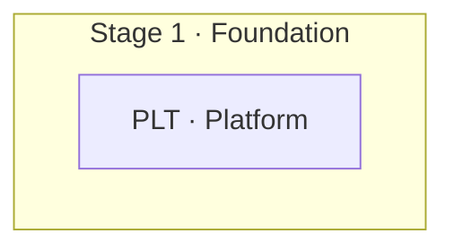

# {{title}} — Roadmap

Single source of truth for stages, epics and features. Synced to GitHub with `gh roadmap sync`.

| Level | In this file | In GitHub |
|---|---|---|
| Stage | Mermaid `subgraph S1["Stage 1 · …"]` | Milestone `Stage 1` |
| Module | Code in `roadmap.config.json` → `modules` | Label `module:<name>`, Project field `Module` |
| Epic | Mermaid node `E_PLT_S1["PLT · …"]` (module × stage) | Parent issue with sub-issues |
| Feature | Row in the registry, ID `PLT-01` | Sub-issue; title starts with the feature ID |

Feature IDs are permanent: never reuse or renumber them. The registry `Status` column accepts `todo`, `done` or `dropped` (a dropped feature's issue is closed as not planned). The live status is on the Project board.

## Board workflow

| Column | Meaning |
|---|---|
| **Backlog** | Not ready: details or decisions are missing |
| **Todo** | Ready to start |
| **In Progress** | Being worked on |
| **Blocked** | Started, but stopped by a problem (comment says what blocks it) |
| **Done** | Merged — set automatically when the PR with `Closes #N` is merged |
| **Deployed on Stage** / **Deployed on Prod** | Deployed to the environment |

---

## Epics by stage

### Epic issues

<!-- epics:start -->
_Filled in by `gh roadmap sync`._
<!-- epics:end -->

---

## Feature registry

### Stage 1 · Foundation

| ID | Epic | Feature | Depends on | Status | Issue |
|---|---|---|---|---|---|
| PLT-01 | E_PLT_S1 | Repository and tooling setup | — | todo | |
| PLT-02 | E_PLT_S1 | CI: lint, typecheck, tests | PLT-01 | todo | |
